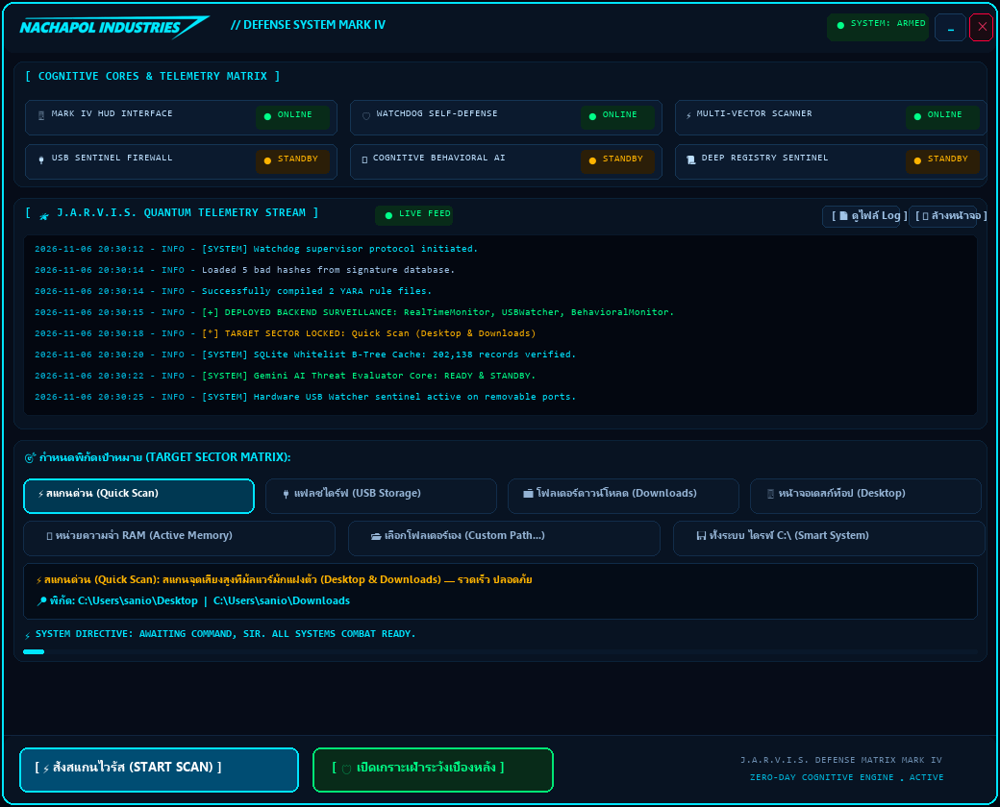

<div align="center">

# 🛡️ Scan Viruses ⚡

*ระบบสแกนและกำจัดไวรัสอัจฉริยะแบบเรียลไทม์ พร้อมหน้าจอควบคุมโฮโลแกรมและขุมพลังวิเคราะห์จาก Gemini AI*

[](https://github.com/sanior09/Scan-viruses/stargazers)
[](https://github.com/sanior09/Scan-viruses/network/members)
[](https://www.python.org/)
[](https://github.com/TomSchimansky/CustomTkinter)
[](https://ai.google.dev/)
[](https://sqlite.org/)
[](LICENSE)

<br/>

[✨ ฟีเจอร์เด่น](#-ฟีเจอร์เด่นและไฮไลท์ของระบบ) • 
[🎯 โหมดการสแกน](#-พิกัดและโหมดการสแกน-7-รูปแบบ) • 
[🚀 เริ่มต้นใช้งาน](#-วิธีการติดตั้งและเปิดใช้งาน-getting-started) • 
[📌 โครงสร้างโปรเจกต์](#-โครงสร้างไฟล์ในโปรเจกต์) • 
[🤝 การมีส่วนร่วม](#-การมีส่วนร่วมพัฒนา-contributing)

<br/><br/>

<p align="center">
  
</p>

</div>

---

## 📖 เกี่ยวกับโปรเจกต์ (About Project)

**"Scan Viruses"** เป็นชุดโปรแกรมรักษาความปลอดภัยและตรวจจับภัยคุกคามสำหรับเครื่องคอมพิวเตอร์ (Tactical Antivirus & Lightweight EDR) ที่ถูกพัฒนาขึ้นด้วยภาษา Python เพื่อให้ผู้ใช้สามารถปกป้องเครื่องได้อย่างมีประสิทธิภาพ รวดเร็ว และไม่กินทรัพยากรเครื่อง

ตัวโปรแกรมผสานการตรวจจับไวรัสแบบดั้งเดิม (YARA Rules & Bad Hash Signatures) เข้ากับหลักการทางวิทยาศาสตร์ด้าน Heuristics (การคำนวณ Shannon Entropy และวิเคราะห์ PE Imports) ควบคู่ไปกับระบบตรวจตราเบื้องหลังตลอด 24 ชั่วโมง และสามารถส่งไฟล์หรือพฤติกรรมที่น่าสงสัยไปให้ **Google Gemini AI** ร่วมประเมินสถานการณ์ได้อย่างแม่นยำ พร้อมหน้าต่างแดชบอร์ดสไตล์ไซไฟที่ตอบสนองลื่นไหล ไม่มีอาการค้าง

---

## ✨ ฟีเจอร์เด่นและไฮไลท์ของระบบ

```
   ┌────────────────────────────────────────────────────────────────────────┐
   │                     🛡️ SCAN VIRUSES CORE SYSTEM                        │
   ├──────────────────┬──────────────────┬──────────────────────────────────┤
   │ 🔍 Deep Scanner  │ ⚡ Tactical HUD   │ 🧠 Gemini AI Core                │
   │ คำนวณ SHA-256    │ Quantum Telemetry│ ประเมินพฤติกรรม                  │
   │ ค่า Shannon      │ Matrix ไร้ขอบ    │ ภัยคุกคาม Zero-Day               │
   │ Entropy และ YARA │ ฟอนต์คมชัดระดับ  │ ผ่าน Structured                  │
   │ ตัดสินแม่นยำ     │ High-DPI Display │ JSON Protocol                    │
   ├──────────────────┼──────────────────┼──────────────────────────────────┤
   │ 👁️ RealTime Guard│ 🔌 USB Auto-Scan │ 🔐 Persistence Watcher           │
   │ ดักจับไฟล์เข้าใหม่│ กำจัดไวรัสใน     │ เฝ้าระวัง Windows Registry,      │
   │ ใน Downloads     │ แฟลชไดรฟ์ทันที   │ โฟลเดอร์ Startup                 │
   │ และโฟลเดอร์ Temp │ แบบ Background   │ และ Services แอบแฝง              │
   └──────────────────┴──────────────────┴──────────────────────────────────┘
```

### ⚡ จุดเด่นสำคัญ:
- **🎨 Futuristic Cyber Tactical HUD:** หน้าจอควบคุมดีไซน์ล้ำสมัยด้วย CustomTkinter พร้อม Cognitive Cores Matrix 3x2, สตรีม Telemetry แบบเรียลไทม์ และระบบเรนเดอร์ภาษาไทยคมชัดสูงด้วย Leelawadee UI + Windows DPI-Awareness
- **⚡ Ultra-Fast SQLite Whitelist:** ปรับปรุงแคชไฟล์ปลอดภัยสู่ฐานข้อมูล SQLite ทำให้อ่านข้อมูลเร็วกว่าเดิมในระดับ 0.00 มิลลิวินาที ไม่ค้างหน่วง
- **🛡️ Safe Quarantine Isolation:** กักกันไฟล์อันตรายไปยังห้องนิรภัย `Quarantine/` ด้วยนามสกุล `.jarvis_locked` ปลอดภัยโดยไม่มีการลบไฟล์ทิ้งถาวร
- **🧠 Zero-Day AI Consultation:** มีระบบขอความเห็นจาก AI (Google Gemini) ในกรณีที่พบไฟล์บีบอัดข้อมูลสูงหรือคำสั่งสคริปต์ที่น่าสงสัย
- **🐕 Self-Defense Watchdog:** สคริปต์ตรวจตราตัวเอง คอยปลุกชีพเซอร์วิสเฝ้าระวังเบื้องหลังให้กลับมาทำงานอัตโนมัติหากเกิดข้อผิดพลาด

---

## 🎯 พิกัดและโหมดการสแกน 7 รูปแบบ

| โหมดสแกน | สัญลักษณ์ | ขอบเขตการทำงาน | ความเร็ว |
|---|:---:|---|:---:|
| **Quick Scan** | ⚡ | สแกนโฟลเดอร์ Desktop และ Downloads ซึ่งเป็นเป้าหมายหลักของไฟล์แปลกปลอม | เร็วมาก |
| **USB Flash Drive** | 🔌 | สแกนแฟลชไดรฟ์และ Removable Drives ทุกตัวที่เชื่อมต่อ เพื่อกำจัดไวรัสซ่อนไฟล์/Autorun | รวดเร็ว |
| **Downloads** | 📁 | สแกนเจาะลึกเฉพาะไฟล์ที่ดาวน์โหลดมาจากอินเทอร์เน็ต | ปานกลาง |
| **Desktop** | 🖥️ | ตรวจสอบไฟล์ โปรแกรม และชอร์ตคัตทั้งหมดบนหน้าจอเดสก์ท็อป | รวดเร็ว |
| **RAM Active Memory** | 🧠 | ตรวจสอบโปรเซสที่กำลังทำงานอยู่ในหน่วยความจำ คำสั่งแฝง และพารามิเตอร์แปลกปลอม | ทันที |
| **Custom Sector** | 📂 | เลือกสแกนเฉพาะโฟลเดอร์หรือไดรฟ์ที่กำหนดเองได้อย่างอิสระ | ตามขนาดโฟลเดอร์ |
| **Full System** | 💾 | สแกนลึกทั้งไดรฟ์ C:\ พร้อมระบบคัดกรองข้ามไฟล์ระบบ (Smart Exclusions) | ละเอียด |

---

## 📌 โครงสร้างไฟล์ในโปรเจกต์

```
Scan-viruses/
├── assets/
│   ├── dashboard_preview.png # ภาพพรีวิวหน้าต่าง Tactical Cyber HUD
│   └── logo_cyan.png         # โลโก้ส่วนต่อประสาน
├── signatures/
│   ├── bad_hashes.txt        # ฐานข้อมูล Hash ไวรัสที่รู้จัก
│   ├── standard.yar          # กฎ YARA สำหรับมัลแวร์ทั่วไปและ PE Injection
│   └── scripts.yar           # กฎ YARA สำหรับสคริปต์อันตราย (PowerShell, VBS)
├── AI_Analyzer.py            # โมดูลวิเคราะห์พฤติกรรมผ่าน Google Gemini 2.5 Flash
├── BehavioralMonitor.py      # โมดูลตรวจพฤติกรรมโปรเซส (Disk I/O & Network Ports)
├── Dashboard.py              # หน้าจอควบคุมหลัก (Futuristic Cyber Tactical HUD & Telemetry)
├── RealTimeMonitor.py        # เซอร์วิสเฝ้าระวังไฟล์เข้าใหม่แบบเรียลไทม์
├── RegistrySurveillance.py   # ตรวจจับการฝังตัวใน Windows Registry และ Services
├── Scan.py                   # กลไกแกนสแกนหลัก (Hashing, Entropy, YARA, SQLite Whitelist)
├── USBWatcher.py             # เซอร์วิสตรวจจับและสแกนแฟลชไดรฟ์อัตโนมัติ
├── Watchdog.py               # ระบบพิทักษ์และกู้ชีพโปรเซสสายตรวจ
├── run_scanner.bat           # สคริปต์สำหรับเปิดระบบสแกนอัตโนมัติในคลิกเดียว
├── requirements.txt          # รายการไลบรารีที่จำเป็นสำหรับโปรเจกต์
├── LICENSE                   # สัญญาอนุญาตการใช้งาน Open-Source แบบ MIT
└── README.md                 # เอกสารแนะนำและคู่มือการใช้งานระบบ (เอกสารนี้)
```

---

## 🚀 วิธีการติดตั้งและเปิดใช้งาน (Getting Started)

ท่านสามารถดาวน์โหลดและรันโปรเจกต์บนระบบปฏิบัติการ Windows ได้อย่างง่ายดาย:

### 1. โคลนคลังโค้ด (Clone Repository)
```bash
git clone https://github.com/sanior09/Scan-viruses.git
cd Scan-viruses
```

### 2. ติดตั้ง Dependencies
```bash
pip install -r requirements.txt
```

### 3. ตั้งค่าสภาพแวดล้อม (`.env`)
คัดลอกไฟล์ `.env.example` เป็น `.env` และใส่คีย์ของ Google Gemini (ทางเลือกเสริม):
```env
# Google Gemini API Key สำหรับระบบวิเคราะห์เชิงลึก
GEMINI_API_KEY=AIzaSyYourGeminiAPIKeyHere
```
*(หากไม่ระบุ API Key โปรแกรมจะใช้ระบบฐานข้อมูล Signature และ Heuristic ภายในเครื่องทำงานได้เต็มรูปแบบ 100%)*

### 4. เปิดใช้งานระบบ (System Execution)

เลือกวิธีใดวิธีหนึ่งตามความสะดวกของท่าน:

* **วิธีที่ 1 (แนะนำสำหรับ Windows):**  
  ดับเบิลคลิกไฟล์ **`run_scanner.bat`** เพื่อเปิดแดชบอร์ดพร้อมสตาร์ทระบบเฝ้าระวัง

* **วิธีที่ 2 (ผ่าน Command Line):**
  ```bash
  python Dashboard.py
  ```

* **วิธีที่ 3 (สแกนไฟล์เดี่ยวแบบ Standalone):**
  ```bash
  python Scan.py --no-pause "C:\path\to\file.exe"
  ```

---

## 🤝 การมีส่วนร่วมพัฒนา (Contributing)

ยินดีต้อนรับทุกคำแนะนำ กฎ YARA ใหม่ๆ และการส่ง Pull Request เพื่อพัฒนาขีดความสามารถของระบบ:

1. ทำการ **Fork** โปรเจกต์นี้
2. สร้าง Feature Branch ของท่าน (`git checkout -b feature/NewFeature`)
3. ทำการ Commit การเปลี่ยนแปลง (`git commit -m 'Add some NewFeature'`)
4. Push ขึ้นสู่ Branch ของท่าน (`git push origin feature/NewFeature`)
5. เปิด **Pull Request** เพื่อตรวจสอบและรวมโค้ด

---

## 📄 สัญญาอนุญาต (License)

โปรเจกต์นี้เผยแพร่ภายใต้สัญญาอนุญาต **MIT License** — ท่านสามารถนำไปศึกษา พัฒนาต่อยอด หรือดัดแปลงได้อย่างเสรี ดูรายละเอียดเพิ่มเติมได้ที่ไฟล์ [LICENSE](LICENSE)

---

<div align="center">

สร้างสรรค์ด้วยความใส่ใจในความปลอดภัยของระบบ 🩵 โดย [sanior09](https://github.com/sanior09)

*หากโปรเจกต์นี้มีประโยชน์ต่อท่าน อย่าลืมกด ⭐️ Star ให้กับ Repository นี้นะครับ!*

</div>
